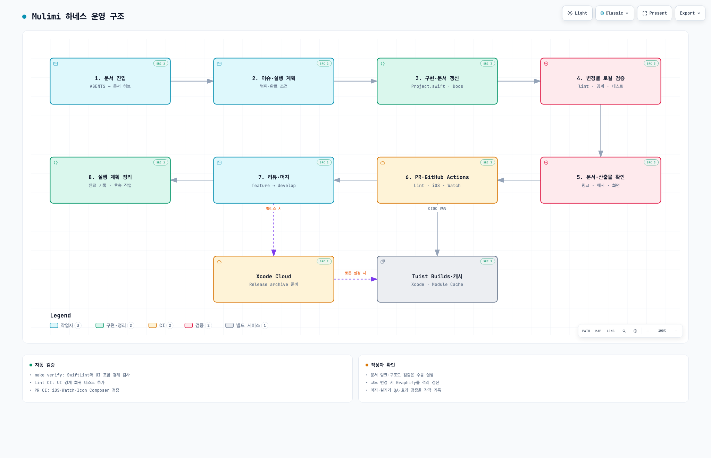

# Harness Engineering Structure

Mulimi에서 말하는 하네스 엔지니어링은 AI 에이전트와 개발자가 같은 기준으로 작업할 수 있게 문서, 규칙, 검증 흐름을 구조화하는 운영 레이어다. 이 문서는 각 문서가 어떤 책임을 갖는지와 어디를 먼저 읽어야 하는지를 정리한다.

## Goals

- 작업 시작 전에 읽어야 할 문서를 빠르게 찾게 한다.
- 제품 요구, 구조 규칙, 실행 계획, 검증 규칙을 분리한다.
- 문서가 늘어나도 SSOT가 어디인지 헷갈리지 않게 한다.

## Operating Map



[운영 구조도 HTML](diagrams/mulimi-harness-architecture.html) · [원본 JSON](diagrams/mulimi-harness-architecture.json) · [라이트·다크 화면 검증](diagrams/mulimi-harness-architecture.visual-check.html)

번호는 작업 순서이며 점선은 별도 릴리스 흐름이다. 문서와 영향받는 산출물은 PR 전에 갱신하고, 머지 후에는 실행 계획 상태·후속 작업·인덱스를 정리한다. CI 실패 시 구현·검증 단계로 돌아간다. Xcode Cloud의 시작 조건과 실제 실행 결과는 콘솔에서 확인한다.

그림은 2026-10-26에 확인한 `release/2.7.0@5b08b19`의 규칙·스크립트를 근거로 하며, 각 노드에서 해당 커밋의 파일을 열 수 있다. 앱 모듈 의존성은 [앱 구조·의존성 스냅샷](project-architecture-and-dependencies.md)을 참고한다. 설명은 한국어이며 archify의 고정 Viewer UI와 `<html lang>`는 영어다.

## Top-Level Map

```text
AGENTS.md          -> 작업 규칙과 읽기 순서
CLAUDE.md          -> AGENTS.md symlink 진입 포인터
GEMINI.md          -> AGENTS.md symlink 진입 포인터
README.md          -> 제품 개요와 개발 시작점
ARCHITECTURE.md    -> 구조 SSOT
Project/**/Project.swift -> 실제 타깃·직접 의존 선언
Docs/index.md      -> 문서 허브
Docs/project-architecture-and-dependencies.md -> 코드 기준 구조·의존성 스냅샷
Docs/diagrams      -> 구조도 원본·HTML·화면 검증 산출물
Docs/product-specs -> 사용자 흐름 요구사항
Docs/skills        -> 구현 전 체크리스트
Docs/exec-plans    -> 실행 계획과 기술 부채
Docs/quality-gates.md -> 변경 유형별 검증 기준
Docs/documentation-maintenance.md -> 문서 유지보수 규칙
Docs/delivery-workflow.md -> 이슈, 브랜치, PR 전달 흐름
Docs/security-privacy.md -> 보안/개인정보 운영 기준
Docs/*.md          -> 도메인/설계 배경 문서
.codex/skills/graphify -> Codex용 코드 지식 그래프 스킬
.graphifyignore    -> Graphify 분석 제외 범위
graphify-out       -> 공유 코드 지식 그래프
.github/workflows/lint.yml -> PR lint와 architecture check
.github/workflows/pr-unit-tests.yml -> PR 단위 Unit Test
.github/workflows/tuist-preview.yml -> 시뮬레이터 Preview 공유
.github/workflows/ai-pr-review.yml -> Git Flow PR AI 리뷰
ci_scripts/ci_post_clone.sh -> Xcode Cloud post-clone 준비
```

## Reading Path

1. `AGENTS.md`
2. `README.md`
3. `ARCHITECTURE.md`
4. `Docs/index.md`
5. 작업 대상 이슈
6. 브랜치/PR 기준이 필요하면 `Docs/delivery-workflow.md`
7. 관련 도메인 문서 또는 `Docs/product-specs/`
8. 관련 `Docs/skills/`
9. 실제 코드와 `Project.swift`

## Document Roles

### `AGENTS.md`
- 작업 순서, 금지 규칙, 기본 검증 절차
- 에이전트/자동화 작업의 운영 기준

### `CLAUDE.md`, `GEMINI.md`
- 도구별 진입점
- 공통 규칙을 복제하지 않고 `AGENTS.md`를 가리키는 symlink
- 도구 전용 예외가 필요해지면 먼저 `AGENTS.md`의 공통 규칙으로 흡수 가능한지 검토

### `README.md`
- 저장소 소개
- 기술 스택, 실행 방법, 빠른 문서 진입점

### `ARCHITECTURE.md`
- 레이어 책임
- 데이터 source of truth
- 전역 구조 규칙의 SSOT

### `Docs/project-architecture-and-dependencies.md`, `Docs/diagrams/`

- 실제 `Project.swift`와 구현을 확인한 구조·직접 의존성 스냅샷, 소스 위치와 검토 기준 커밋
- 구조도는 주요 관계를 묶은 개요이며 모든 타깃 간선을 대신하지 않음
- 규칙은 `ARCHITECTURE.md`, 실제 선언은 `Project.swift`를 우선하고 스냅샷은 코드 변경에 맞춰 갱신
- README와 문서 허브에서 같은 문서·구조도를 연결하고 전체 타깃 표를 복제하지 않음

### `Docs/index.md`
- 문서 허브
- 어떤 상황에 어떤 문서를 읽어야 하는지 연결

### `Docs/product-specs/`
- 현재 사용자 흐름 요구사항
- 화면이나 상태 전이가 바뀌면 먼저 갱신할 문서

### `Docs/skills/`
- 구현 전에 확인할 기술 규칙
- 예: 아키텍처 경계, HealthKit 흐름, 내비게이션, 워치/위젯, 검증 순서

### `Docs/exec-plans/`
- 긴 작업의 계획과 결정 기록
- 진행 중 작업, 완료 기록, 기술 부채 추적
- 새 실행 계획은 `Docs/exec-plans/template.md`를 복사해 작성

### `Docs/*.md`
- 특정 도메인에 대한 깊은 설계 배경
- 예: 챌린지 상태, 개인화 전략, 프로필 구조

### `Docs/quality-gates.md`
- 변경 유형별 최소 검증 기준
- PR 본문에 어떤 검증을 적어야 하는지 판단하는 기준

### `Docs/documentation-maintenance.md`
- 문서별 SSOT와 갱신 조건
- 새 문서를 만들지 기존 문서를 갱신할지 판단하는 기준

### `Docs/delivery-workflow.md`
- 이슈를 브랜치, 커밋, PR로 전달하는 기준
- 기능 PR과 릴리스 PR의 base/head 분리 규칙
- PR 템플릿 작성과 검증 결과 보고 기준

### `Docs/security-privacy.md`
- 민감 데이터 저장소, 권한, 외부 SDK, App Store privacy label 영향 검토 기준
- 광고/IAP/서버 연동 전 확인할 개인정보 체크리스트

## Automation Harness

하네스 자동화는 로컬, GitHub Actions, Xcode Cloud의 책임을 분리한다.

검토 기준: `5b08b19` (2026-10-26). 각 파일에 선언된 실행 조건과 검증 범위를 정리했다.

| 실행 지점 | 근거 파일 | 실행 조건·검증 범위 |
| --- | --- | --- |
| 로컬 명령 | `Makefile`, `scripts/lint.sh`, `scripts/lint-fix.sh`, `scripts/check-architecture.sh` | `make verify`는 SwiftLint와 아키텍처 검사만 묶는다. 아키텍처 검사는 `scripts/check-ui-boundaries.py`를 포함한다. |
| UI 경계 회귀 검사 | `scripts/test-ui-boundaries.py` | 검사기 변경 시 로컬에서 별도 실행한다. `make verify`와 커밋 훅에는 포함되지 않는다. |
| 커밋 훅 | `.githooks/pre-commit` | `make hooks`로 설치한다. 추가·복사·수정·이름 변경된 staged `.swift` 경로가 있으면 해당 파일의 SwiftLint와 전체 아키텍처 검사를 실행한다. 문서만 변경하거나 Swift 파일 삭제만 있는 커밋은 건너뛴다. |
| Lint CI | `.github/workflows/lint.yml` | `main`·`develop` 대상 PR과 수동 실행에서 SwiftLint, 아키텍처 검사, UI 경계 회귀 테스트를 실행한다. |
| PR Unit Tests | `.github/workflows/pr-unit-tests.yml` | 같은 저장소 PR·수동 실행은 OIDC 인증, Xcode Cache 준비, 외부 모듈 캐시 생성 후 프로젝트를 생성한다. fork PR은 클라우드 기능을 끈다. Icon Composer와 iOS 16개 스킴·Watch를 검증하고 `tuist xcodebuild`로 기록을 전송한다. [빌드·테스트 절차](skills/xcode-build-test.md#pr-ci-scope)를 따른다. |
| Local / GitHub Actions | `scripts/tuist-preview.py`, `.github/workflows/tuist-preview.yml` | Debug 시뮬레이터 앱과 Widget/Watch를 검증하고 Tuist에 공유한다. Xcode·외부 모듈 캐시와 Builds를 사용하며 같은 저장소의 `develop` 대상 PR과 수동 실행을 지원한다. |
| AI PR Review | `.github/workflows/ai-pr-review.yml` | Git Flow에 맞는 non-draft PR의 생성·ready 전환에서 실행한다. 키·텍스트 diff가 없으면 리뷰를 생략한다. 조건은 [전달 흐름](delivery-workflow.md#ai-review-automation)을 따른다. |
| Xcode Cloud | `ci_scripts/ci_post_clone.sh` | PostHog 설정·도구·아이콘을 준비한다. `TUIST_TOKEN`이 있으면 Tuist 캐시와 기록을 활성화하고 없으면 클라우드 기능을 끈다. Release 프로젝트를 생성하며 archive·서명·배포는 [Cloud 콘솔 설정](xcode-cloud-release-build.md#2-xcode-cloud-워크플로-생성)을 따른다. |
| 수동 문서·구조도 검증 | `Docs/diagrams/`, 로컬 archify 스킬 | 링크·소스 근거를 대조하고 구조도 원본에서 HTML·화면 검증 산출물을 생성한다. |
| 수동 그래프 갱신 | `.codex/skills/graphify`, `.graphifyignore`, `graphify-out/` | 코드 변경 후 격리된 출력 경로에서 공유 산출물 4개를 갱신한다. 아래 Graphify Artifacts 절차를 따른다. |

Lint와 PR Unit Tests는 PR 생성·동기화·재열기 및 수동 실행을 지원한다. draft·문서 전용 PR을 제외하는 조건은 없다. Xcode Cloud post-clone은 아이콘 유형 보정만 실행하며, 아이콘 회귀·Resources 연결 검사는 PR Unit Tests와 로컬 검증에서 수행한다.

검사기는 Swift import와 리터럴 Tuist 의존 선언을 확인한다. 전체 Swift 의미 분석이나 빌드를 대신하지 않는다. 세부 검사 범위·수정 순서는 [린트 절차](skills/lint-fix-loop.md)를 따른다.

PR 본문에는 로컬에서 직접 실행한 검증과 GitHub Actions/Xcode Cloud가 실행한 검증을 구분해서 적는다.

Preview 생성·인증·리뷰어 실행 절차는 [Tuist Previews](tuist-previews.md)를 따른다. `make preview-check`는 업로드 전 회귀 검사이고, 실제 공유와 시뮬레이터 실행 결과는 PR에 따로 기록한다.

Tuist Builds·Xcode Cache·Module Cache 설정과 인증 없는 실행은 [Tuist Builds와 캐시](tuist-builds-and-cache.md)가 기준이다. `make generate`는 캐시 서비스를 준비하고, `make tuist-cache`는 기본적으로 외부 라이브러리 바이너리를 공유한다.

문서 링크 검사와 구조도 검증은 현재 `make verify`, pre-commit, GitHub Actions에 자동으로 포함되지 않는다. 작성자가 [문서·구조도 품질 게이트](quality-gates.md#architecture-artifact-gate)를 별도로 확인한다.

### Graphify Artifacts

- `graphify-out/graph.json`, `GRAPH_REPORT.md`와 라벨·서명 파일은 공유 산출물로 함께 갱신한다. `.graphify_labels.json.sig`는 커뮤니티 구성이 바뀌었을 때 오래된 라벨을 재사용하지 않게 하는 정보다.
- `graphify-out/`의 HTML, `manifest.json`, 비용·캐시·어휘·학습 상태, 날짜별 백업, `memory/`, `reflections/`는 `.gitignore`로 제외하고 로컬에 보존한다. 세션에서 얻은 장기적인 결정은 `Docs/`에 정리한다.
- `.graphifyignore`는 `graphify-out/` 전체를 분석 입력에서 제외한다. 이미 저장된 그래프 조회에는 영향을 주지 않는다.

Graphify는 `memory/`를 ignore와 무관하게 읽고 학습 요약을 보고서에 붙일 수 있다. 공유용 갱신은 저장소 루트에서 아래처럼 임시 출력 경로를 사용한다. 기존 그래프와 라벨만 복사하므로 코드·문서 관계는 보존하면서 세션 기록은 읽지 않는다.

```sh
(
  set -eu
  mulimi_graph_out="$(mktemp -d)"
  trap 'rm -rf -- "$mulimi_graph_out"' EXIT
  cp graphify-out/graph.json graphify-out/GRAPH_REPORT.md \
    graphify-out/.graphify_labels.json graphify-out/.graphify_labels.json.sig "$mulimi_graph_out/"
  GRAPHIFY_OUT="$mulimi_graph_out" graphify update .
  cp "$mulimi_graph_out/graph.json" "$mulimi_graph_out/GRAPH_REPORT.md" \
    "$mulimi_graph_out/.graphify_labels.json" "$mulimi_graph_out/.graphify_labels.json.sig" \
    graphify-out/
)
```

공유 전에는 생성물 출처 노드와 세션 학습 섹션이 없는지 확인한다.

```sh
jq -e 'all(.. | objects | .source_file? | strings; startswith("graphify-out/") | not)' graphify-out/graph.json
! rg -n '^## Work-memory lessons' graphify-out/GRAPH_REPORT.md
```

AST-only 갱신을 문서의 의미적 재분석으로 보고하지 않는다. 문구·링크만 바뀐 경우 원문을 확인하며, 이를 이유로 전체 그래프를 재생성하지 않는다.

### Architecture Artifacts

- [구조·의존성 문서](project-architecture-and-dependencies.md)는 실제 타깃 목록·소스 공유·실행 경계를 설명한다. 타깃 수와 검토 기준 커밋도 이 문서에서 관리한다.
- 원본은 아래 두 구조도로 관리한다. `meta.repository.revision`과 `sources`에는 실제 확인한 커밋·파일 위치를 기록한다.
- 같은 이름의 HTML, `*.visual-check.json`, 라이트·다크 PNG 4장, `*.visual-check.html`은 배포·검증 산출물로 Git에 함께 보관한다. 로컬 상태인 `graphify-out/graph.html`과 구분한다.
- 원본을 수정하면 archify의 `validate → deliver → visual-check → 캡처 직접 확인` 순서로 다시 검증한다. HTML을 직접 편집하거나 원본과 다른 HTML의 해시·화면 검증 결과를 재사용하지 않는다.
- 합격 기준은 [품질 게이트](quality-gates.md#architecture-artifact-gate)를 따른다. README 링크·설명만 변경했다면 기존 구조도를 불필요하게 재생성하지 않는다.

| 구조도 | 원본·HTML의 공통 이름 | 근거·갱신 조건 |
| --- | --- | --- |
| 앱 구조·의존성 | `mulimi-project-architecture` | `Project.swift`·구현의 타깃, 직접 의존성, 소스 공유 경계가 바뀔 때 |
| 하네스 운영 | `mulimi-harness-architecture` | 문서 진입, 검증 스크립트, CI, 머지 후 정리 흐름이 바뀔 때 |

archify 설치 디렉터리에서 실행한다. `mulimi_repo`는 저장소의 절대 경로로, `mulimi_diagram`은 위 표에서 영향받은 이름으로 지정한다.

```sh
mulimi_repo="/absolute/path/to/Mulimi"
mulimi_diagram="mulimi-harness-architecture"
node bin/archify.mjs validate architecture "$mulimi_repo/Docs/diagrams/$mulimi_diagram.json" --quality showcase --repo-root "$mulimi_repo" --json
node bin/archify.mjs deliver architecture "$mulimi_repo/Docs/diagrams/$mulimi_diagram.json" "$mulimi_repo/Docs/diagrams/$mulimi_diagram.html" --quality showcase --repo-root "$mulimi_repo" --json
node bin/archify.mjs visual-check "$mulimi_repo/Docs/diagrams/$mulimi_diagram.html" --json
```

검토 커밋이 오래됐다는 이유만으로 해시·캡처를 새 결과로 바꾸지 않는다. 코드가 같다면 재검토 날짜와 비교 범위를 문서에 추가하고 기존 산출물의 생성 이력을 보존한다.

### Harness Artifact Validation

2026-10-26, archify 2.16 / Node.js 24.18.1 / Google Chrome에서 Tuist Builds·캐시와 CI 인증 경로를 추가한 운영 구조도를 검증했다. 근거 파일 참조는 중복 포함 25개다. 앱 구조도의 이전 검증 기록은 [구조·의존성 문서](project-architecture-and-dependencies.md#생성-검증-결과)에 보존한다.

```text
diagram_type: architecture
output: Docs/diagrams/mulimi-harness-architecture.html
source_revision: 5b08b19ecdc94e391a561c10586a46404721674b
specification_sha256: 763d9f9915b7b316b7e1f7fff2708ba7e551871a6bec621d86ceff95f94de6cd
specification_bytes: 5989
artifact_sha256: 271bf0d2cfb54aaaccad3785325c949e4512218b7f291c1fdd5d4e9a62e66797
artifact_bytes: 713135
validation: 9/9 showcase, 0 errors, 0 warnings
visual_review: passed
correction_rounds: 1 (OIDC 인증 라벨 위치)
```

자동 검증은 1440×900, 1600×1000, 1920×1080, 2048×1320에서 넘침 없음과 캡처 생성을 확인했다. 1440×900·2048×1320의 라이트·다크 캡처 4장을 직접 확인해 라벨·화살표·범례·카드가 잘리지 않는 것을 확인했다. `visual-check.json`의 `visualReview: pending`은 자동 검증 결과로 유지하며, 이 문단이 별도의 육안 검증 기록이다. 원본·HTML의 실제 SHA-256 및 바이트 수와 화면 검증 receipt를 대조한다.

## Update Rules

- 제품 요구 변경: `Docs/product-specs/` 우선 갱신
- 구조 규칙 변경: `ARCHITECTURE.md`와 관련 `Docs/skills/` 갱신
- 타깃·의존성·소스 공유·실행 경계 변경: `Project.swift` 및 구현을 기준으로 구조·의존성 문서와 관련 구조도 갱신
- 검증 기준 변경: `Docs/quality-gates.md`와 관련 `Docs/skills/` 갱신
- 이슈/PR 운영 기준 변경: `Docs/delivery-workflow.md`와 필요한 템플릿 갱신
- 보안/개인정보 경계 변경: `Docs/security-privacy.md` 갱신
- 에이전트 공통 규칙 변경: `AGENTS.md` 갱신, 도구별 파일은 포인터 상태 유지
- Graphify 분석 범위 변경: `.graphifyignore`와 `graphify-out/`을 함께 갱신
- 문서 구조 변경: `Docs/documentation-maintenance.md`, `Docs/index.md`, `README.md` 링크 갱신
- 긴 작업 시작: `Docs/exec-plans/active/`에 계획 기록
- 긴 작업 종료: [머지·완료 조건](delivery-workflow.md#merge-and-issue-closure)을 확인하고 계획 상태·후속 항목·인덱스를 함께 갱신
- 코드와 문서가 어긋나면 코드를 먼저 확인하고 작업 끝에 문서를 맞춘다

## Toolchain Policy

현재 하네스는 최신 Apple 개발 환경을 빠르게 따라가는 운영을 기본값으로 둔다.

- Tuist는 `.mise.toml`의 `4.206.0`으로 고정한다. 버전 변경 시 프로젝트 생성·Preview 빌드·공유 명령을 함께 검증한다.
- GitHub Actions의 iOS 유닛 테스트는 `macos-15` runner와 `latest-stable` Xcode를 사용한다. AI 리뷰는 별도 `ubuntu-latest` job이다.
- CI의 iOS destination은 `iPhone 16 Pro,OS=latest`를 사용한다. Watch는 사용 가능한 watchOS 26+ 기기를 조회해 런타임에 선택한 `id`를 사용한다.
- 로컬 `xcodebuild test`는 가능하면 시뮬레이터 `id`를 사용해 같은 이름의 여러 런타임 충돌을 피한다.

최신 도구 drift로 CI나 로컬 검증이 반복 실패하면, 실패 로그와 영향 범위를 남기고 `.mise.toml`, GitHub Actions Xcode 버전, 문서의 기준 버전을 같은 PR에서 pin한다.

## What Is Intentionally Missing

- `DESIGN.md`, `FRONTEND.md`, `SECURITY.md`, `RELIABILITY.md` 같은 루트 대형 운영 문서는 아직 만들지 않았다.
- 이유는 현재 Mulimi 규모에서 유지비가 더 크기 때문이다.
- 보안/개인정보 운영 기준은 `Docs/security-privacy.md`, 복구·신뢰성 기준은 `Docs/reliability-recovery.md`에 둔다.
- 추가 운영 규칙은 기존 문서로 다루기 어려워질 때만 별도 SSOT로 분리한다.

## Maintenance Principle

- 문서는 많이 두는 것보다 경계가 명확해야 한다.
- 같은 내용을 여러 파일에 복제하지 않는다.
- 루트 문서는 방향을 잡고, `Docs/`는 역할별 세부 문서를 제공하는 구조를 유지한다.
